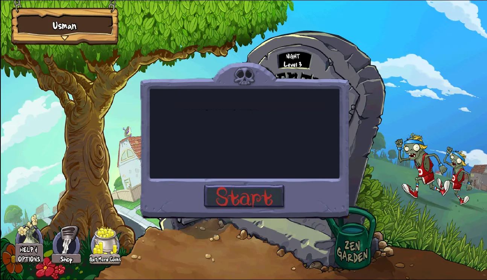
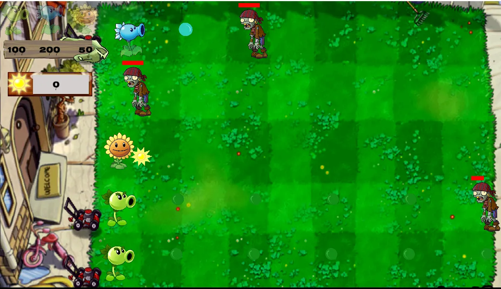
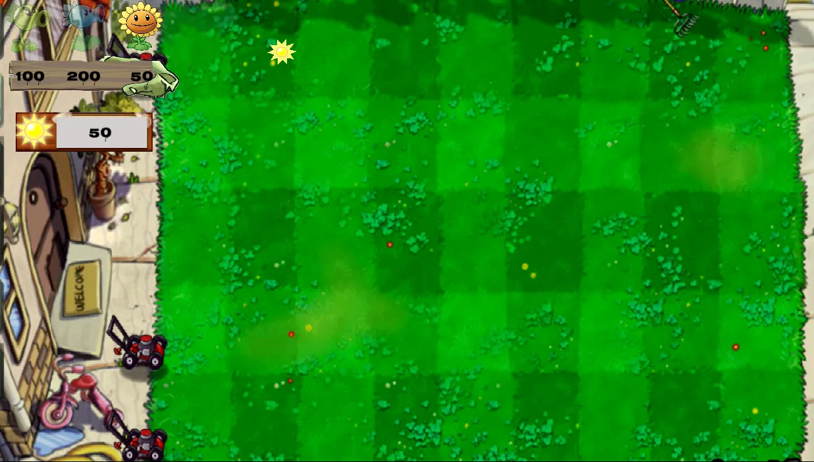

# Usman Khalil - Portfolio

Personal portfolio of **Usman Khalil**, a Software Engineering student at the University of the Punjab working across C++ systems, game development, algorithms, and low-level developer tools.

**Live portfolio:** <https://usman-khalil.github.io/Portfolio/>

## Highlights

- C++ and SFML game development
- MASM-style CPU and memory emulation
- Competitive programming and algorithmic problem solving
- Low-level debugging tools and system programming
- Keyboard-first navigation with an interactive terminal-style interface
- Eight selectable color themes
- Responsive static portfolio with no build step

## Featured Projects

### [Plants Vs Zombies](https://github.com/Usman-Khalil/PlantsVsZombies)

A Windows tower-defense game built in C++ with SFML. It includes plant and zombie managers, sun collection, projectile collisions, multiple zombie rows, health bars, menus, and event-driven rendering.

**Stack:** C++, SFML, OOP, STL, Visual Studio, MSVC

  
  
  

- [Architecture diagram](https://github.com/Usman-Khalil/PlantsVsZombies/blob/main/architecture.txt)
- [Project repository](https://github.com/Usman-Khalil/PlantsVsZombies)

### [Masm Debugger Clone](https://github.com/Usman-Khalil/Masm_Debugger_Project)

A console-based virtual machine and debugger inspired by classic MASM tools. It provides custom CPU registers and flags, memory editing and hex dumps, assembly execution, tracing, breakpoints, memory watches, and a command shell.

**Stack:** C++, MSVC, Git, CPU emulation

- [Project repository](https://github.com/Usman-Khalil/Masm_Debugger_Project)

### [neetcode-submissions](https://github.com/Usman-Khalil/neetcode-submissions)

My C++ solutions to NeetCode practice problems.

**Stack:** C++

### [OOP](https://github.com/Usman-Khalil/OOP)

C++ object-oriented programming coursework covering classes, constructors, destructors, operator overloading, templates, structs, and enums.

**Stack:** C++

## Competitive Programming

I have solved 600+ problems across LeetCode, Codeforces, GeeksforGeeks, AtCoder, and CodeChef.

- [Codeforces](https://codeforces.com/profile/usmankhalil6868)
- [LeetCode](https://leetcode.com/u/usman-k)
- [GeeksforGeeks](https://www.geeksforgeeks.org/profile/usmankha7y0u)
- [GitHub](https://github.com/Usman-Khalil)
- [LinkedIn](https://linkedin.com/in/usman-khalil-868b18381)

## About

I am based in Lahore, Pakistan, and I am pursuing a BS in Software Engineering at the University of the Punjab. I enjoy building practical C++ projects, understanding how software interacts with memory and the CPU, and improving algorithmic problem-solving skills through competitive programming.

## Portfolio Controls

- `j` / `k` - Move through the interface
- `Enter` - Open the selected item
- `:theme` - Change the color theme
- Terminal commands provide additional keyboard navigation

## Project Structure

| Path | Purpose |
|---|---|
| `index.html`, `glimpse.js`, `glimpse.css` | Animated portfolio introduction |
| `site/` | Interactive editor-style portfolio |
| `portfolio.config.json` | Portfolio identity, profile, projects, education, and links |
| `site/shots/` | Project screenshots |
| `serve.py` | Local static development server |
| `scripts/build-data.mjs` | Regenerates generated portfolio data |

## Contact

- Email: [usmankhalil6868@gmail.com](mailto:usmankhalil6868@gmail.com)
- GitHub: [Usman-Khalil](https://github.com/Usman-Khalil)
- LinkedIn: [Usman Khalil](https://linkedin.com/in/usman-khalil-868b18381)

## License

Licensed under the [MIT License](./LICENSE).
